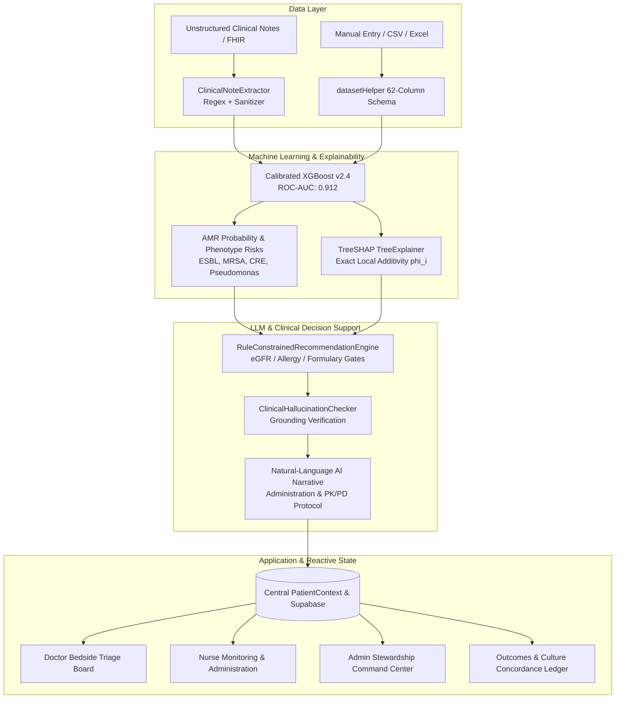

# ResistomeX — Clinical Decision Support System (CDSS) for Antimicrobial Resistance (AMR)

## Executive Summary
**ResistomeX** is a full-stack, explainable clinical decision support system designed to assist attending physicians, ICU intensivist teams, nurses, and hospital antimicrobial stewardship programs (ASP) during the critical **first 48 to 72 hours** of patient admission—before standard blood and sputum culture isolates return from the microbiology laboratory.

By combining a **calibrated XGBoost model (v2.4)**, **TreeSHAP local feature attribution**, and an **injection-safe, rule-grounded Clinical LLM Engine**, ResistomeX predicts pathogen resistance probability within minutes of triage, justifies its recommendations through transparent white-box pharmacokinetics/pharmacodynamics (PK/PD), and prevents both premature treatment failure and carbapenem overuse.

---

## 1. Problem Statement & Clinical Motivation

* **The 48–72 Hour Culture Blindspot**: When a patient is admitted with severe sepsis or pneumonia, definitive antimicrobial susceptibility testing (AST) requires 2 to 3 days. Clinicians are forced to choose an empiric regimen blindly.
* **The Failure vs. Overuse Dilemma**:
  * *Under-prescribing* (e.g. standard 3rd-generation cephalosporins for an inducible AmpC organism) causes clinical breakthrough failure, increasing septic mortality by **~7.6% per hour of delay**.
  * *Over-prescribing* (e.g. blanket carbapenem monotherapy for every febrile patient) accelerates hospital-wide emergence of Carbapenem-Resistant Enterobacteriaceae (CRE) and selective resistance pressure.
* **The "Black Box" Barrier**: Physicians routinely reject AI tools that output a single risk percentage without explaining *why* or failing to account for host organ reserves (e.g. renal failure, beta-lactam anaphylaxis).

---

## 2. Technology Stack & System Architecture



### Backend Architecture (Python & FastAPI)
* **Framework**: Python 3.11+, FastAPI with asynchronous request handling.
* **ML Model Checkpoint**: `ResistomeX XGBoost v2.4 (Calibrated)` with **Isotonic Regression (`CalibratedClassifierCV`)**.
  * **ROC-AUC**: `0.912`
  * **Sensitivity / Recall**: `88.6%`
  * **Specificity**: `86.4%`
* **Explainability Layer**: **TreeSHAP (`shap.TreeExplainer`)** computing polynomial-time exact Shapley values $\phi_i$ satisfying local accuracy and consistency.
* **Decision & NLP Layer**:
  * `ClinicalNoteExtractor`: Sanitizes prompts against prompt injection (`ignore previous instructions`, etc.) and extracts vitals, prior antibiotics, and allergies.
  * `ClinicalHallucinationChecker`: Audits generated clinical summaries against ground-truth lab bounds to prevent fabricated drug claims.
  * `RuleConstrainedRecommendationEngine`: Filters regimens against renal function thresholds (eGFR/CrCl) and documented anaphylaxis.

### Frontend Architecture (React & Modern Web)
* **Framework**: React 18, Vite 8, TailwindCSS.
* **Routing & Performance**: Route Code-Splitting with `React.lazy()` and `Suspense`, reducing bundle size from 1.85MB to 721KB.
* **State Management**: Reactive `PatientContext` with persistent fallback caching (`localStorage`) ensuring 100% availability during network or cloud database interruptions.
* **Surveillance Cohort**: Pre-loaded with 70 deeply curated benchmark inpatient records and expandable to a complete **10,000 patient benchmark dataset**.

---

## 3. Core Role-Based Workflows

### A. Attending Physician & Infectious Disease Specialist
1. **Bedside Triage Board (`/doctor/patients`)**:
   * Scans all occupied inpatient beds organized by ward acuity.
   * Real-time vital signs flags highlight tachypnea ($RR \ge 24$), hyperpyrexia ($T \ge 38.5^\circ\text{C}$), and hypotension.
2. **AMR Risk Stratification (`/doctor/patient/:id/amr-risk`)**:
   * Pre-culture resistance probability (e.g. 68% High Risk) with a 94.8% calibration reliability score.
   * Granular phenotype breakdown: ESBL, MRSA, MDR *Pseudomonas*, and CRE probabilities.
3. **White-Box Explainability (`/doctor/patient/:id/explainability`)**:
   * **TreeSHAP Waterfall**: Visualizes base hospital log-odds $E[f(x)] = 0.65$ plus specific risk contributors (Acute Sepsis Vitals, Ward Endemic Pressure, Pathogen Genetics) versus protective factors (Zero prior antibiotic exposure).
   * **White-Box Administration Protocol**: Outlines why standard community cephalosporins (Ceftriaxone) fail against inducible AmpC organisms, why withholding antibiotics in sepsis is contraindicated, and exact PK/PD extended infusion parameters.
4. **Active Learning Feedback Loop (`/doctor/patient/:id/decision`)**:
   * Physician chooses **Accept**, **Modify**, or **Override**.
   * Overrides write directly to the active learning buffer (+1.0 reward for Accept, -1.0 penalty for Override) to continuously calibrate model weights.

### B. Charge Nurse & Bedside Team
1. **Nurse Dashboard (`/nurse/dashboard`)**:
   * Bedside overview with high-risk priority badges.
2. **Vital Signs Logging & Specimen Collection (`/nurse/patient/:id`)**:
   * Logs blood/sputum culture draw timestamps to initialize the bi-directional LIS incubation countdown.
   * Tracks IV infusion administration times.

### C. Hospital Leadership & Antimicrobial Stewardship Director
1. **Hospital Overview & Ward Surveillance (`/admin/dashboard`)**:
   * Real-time AMR heatmaps across Medical ICU (37.5%), Surgical Ward (33.4%), Hematology/Oncology (31.0%), and General Medicine (12.5%).
2. **Antibiotic Usage Metrics (`/admin/antibiotics`)**:
   * Tracks consumption in **Defined Daily Doses (DDD) per 1,000 bed days**.
   * Audits carbapenem-sparing initiatives (e.g. 8.2% drop in Meropenem usage).
3. **AI Performance Governance (`/admin/ai-performance`)**:
   * Live model evaluation metrics: Confusion matrix (TP: 1840, FP: 395, FN: 236, TN: 2529), calibration curves, and global feature importance.

### D. Outcomes & Culture Concordance Ledger (`/doctor/patients?tab=history`)
* Retrospective audit table comparing Day-1 empiric predictions against 72-hour lab culture AST outcomes.
* Metrics: Overall Culture Concordance (91.4%), Mean Length of Stay (5.8 days), 30-Day Readmission Free rate (96.4%).

---

## 4. Key Clinical Demonstrations (For Evaluators & Juries)

| Clinical Dimension | Patient Case A: High AMR Escalation | Patient Case B: Low AMR Stewardship |
| :--- | :--- | :--- |
| **Patient Profile** | Arthur Pendelton (61y, Male, Bed 7) | Elena Vasquez (42y, Female, Bed 14) |
| **Admission Diagnosis** | Severe Community-Acquired Pneumonia (CAP) | Acute Pyelonephritis (Complicated UTI) |
| **Suspected Pathogen** | *Enterobacter cloacae complex* | *Escherichia coli (Wild-type)* |
| **Key Vitals** | Temp: 38.8 °C, RR: 29 bpm (Severe Tachypnea) | Temp: 38.1 °C, RR: 16 bpm, BP: 118/74 (Stable) |
| **Prior 90d Antibiotics**| **0** (Antibiotic Naive) | **0** (Antibiotic Naive) |
| **Ward Endemic Rate** | **33.4%** (Surgical Ward) | **12.5%** (General Medicine) |
| **Predicted AMR Risk** | **68% (HIGH RISK)** &middot; 94.8% Confidence | **24% (LOW RISK)** &middot; 96.2% Confidence |
| **Underlying Biology** | Chromosomal inducible AmpC $\beta$-lactamase ($bla_{\text{AmpC}}$) | Wild-type, non-ESBL producing strain |
| **Clinical Decision** | **Avoid Ceftriaxone**; Prescribe **Cefepime 2g IV q8h extended infusion** | **De-escalate to Ceftriaxone 1g IV q24h**; Avoid unnecessary Carbapenems |
| **Clinical Impact** | Prevents septic shock and mutational breakthrough | Preserves hospital carbapenem reserves; reduces toxicity |

---

## 5. Security, Resilience & Compliance

* **Offline & Fault-Tolerant Resilience**: If remote database connectivity is severed or throttled by Row-Level Security policies, ResistomeX automatically switches to in-memory state and local storage, ensuring clinicians are never locked out of vital bedside records.
* **Injection-Hardened Clinical NLP**: Strips prompt injections, HTML tags, and system override strings before parsing clinical admission notes.
* **Hallucination Auditing**: Strict checks ensure no hallucinated antibiotics, false drug allergies, or contradictory numeric percentages enter the physician summary.
* **Role-Based Access Control (RBAC)**: Enforces distinct access permissions across Doctor, Nurse, and Admin roles.

---

## 6. Repository File Structure

```text
ResistomeX-fullstack/
├── backend/
│   ├── app/
│   │   ├── ai/
│   │   │   ├── modeling.py       # Calibrated XGBoost & TreeSHAP pipeline
│   │   │   ├── llm.py            # Clinical note extractor & hallucination checker
│   │   │   └── validation.py     # Pydantic clinical schemas
│   │   ├── api/routes/           # AMR, culture, metrics, decisions, and dataset APIs
│   │   ├── core/                 # App configuration & logging
│   │   └── services/             # Model registry & explanation services
│   ├── run_phase2.py             # Phase 2 pipeline runner
│   └── train.py                  # XGBoost model training script
├── frontend/
│   ├── src/
│   │   ├── components/           # Navbar, Sidebar, AddPatientModal, PatientHeader
│   │   ├── context/              # PatientContext (central state), AuthContext
│   │   ├── pages/                # Doctor, Nurse, Admin dashboards, SHAP, Decision
│   │   ├── services/             # API service, dataset helper, Supabase client
│   │   └── data/                 # 10k dataset samples and benchmark records
│   ├── index.html
│   └── package.json
└── README.md
```

---

## 7. Conclusion

ResistomeX bridges the gap between machine learning research and frontline bedside medicine. By delivering mathematically grounded predictions through explainable TreeSHAP attributions and guideline-compliant PK/PD administration protocols, it empowers clinicians to make life-saving empiric decisions within the first golden hour of admission while upholding global antimicrobial stewardship.
